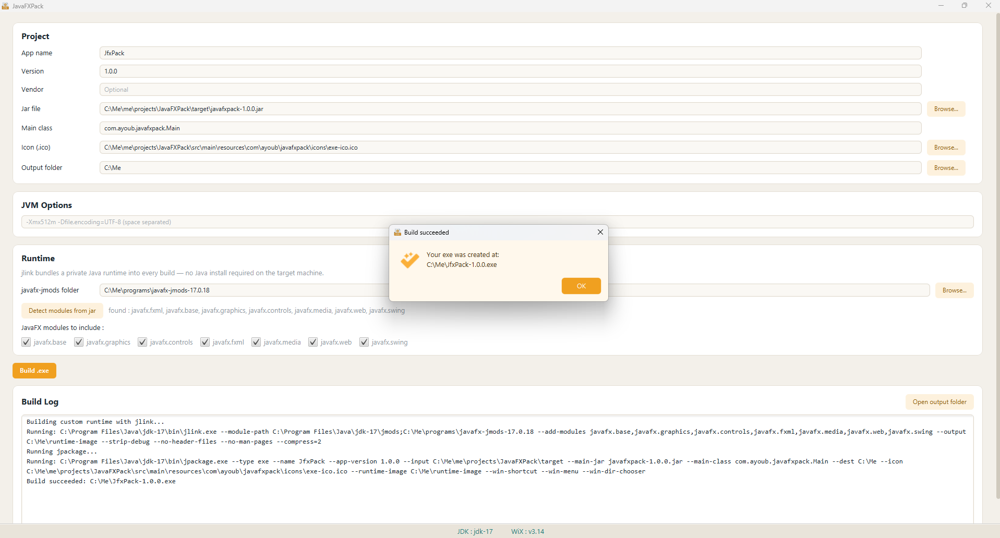

# JavaFXPack

A desktop tool that turns a JavaFX application into a standalone Windows `.exe` installer, without typing `jlink` and `jpackage` commands by hand.

Windows only. Output type is `.exe` only.



## What it does

You pick your app's jar and its dependencies folder, fill in a few fields, and click **Build .exe**. JavaFXPack then :

1. Checks that the JDK and WiX Toolset are installed.
2. Validates your settings and lists every problem at once.
3. Prepares a clean input folder with your jar and its dependency jars (JavaFX jars are left out, because JavaFX goes into the runtime).
4. Finds the JDK modules your app and its dependencies need with `jdeps`.
5. Builds a trimmed private Java runtime with `jlink` (the detected JDK modules + your extra JDK modules + your JavaFX modules).
6. Runs `jpackage` to create the installer, with a desktop shortcut, a Start menu entry and an install folder chooser.
7. Streams the output of every step into a live build log.

The runtime is always built with jlink: a standard JDK doesn't ship JavaFX, so there is no working jpackage path without it. The final exe needs no Java installed on the target machine.

## Features

- Automatic detection of the JDK and its `jpackage`, `jlink` and `jdeps` tools (`JAVA_HOME`, then `C:\Program Files\Java`) and WiX Toolset v3 (`WIX` variable, then Program Files), done in the background at startup.
- Status chips at the bottom showing the detected JDK and WiX versions (green when found, red when missing). The Build button stays disabled until both are found.
- Form for app name, version, vendor, jar, dependencies folder, main class, icon (`.ico`), output folder and JVM options.
- Browse dialogs for the jar, dependencies folder, icon, output folder and javafx-jmods folder.
- **Dependencies folder** (optional): every jar in it is packaged with your app. JavaFX jars (`javafx-*.jar`, or any jar holding `javafx/` classes) are skipped automatically.
- **Automatic JDK modules**: `jdeps` reads your jar and its dependencies and reports the JDK modules they use (for example `java.sql` for JDBC). If jdeps is missing or fails, a default list that covers most desktop apps is used, and the log says so.
- **Extra JDK modules**: for modules jdeps can't see, such as `jdk.localedata` (French, Arabic and other non-English date and number formats) or `jdk.crypto.ec` (HTTPS).
- **Detect modules from jar**: scans the jar's classes and `.fxml` files, and the dependency jars, for JavaFX usage and ticks the matching module checkboxes.
- **Show a console window**: adds `--win-console`, so startup errors are visible instead of the exe silently doing nothing. Use it while testing, then turn it off.
- Pre-flight validation (missing files, wrong icon type, unwritable output folder, invalid dependencies folder, invalid module names, no modules selected, and so on).
- Build runs on a background thread, with a progress bar and live log, so the UI never freezes.
- **Open output folder** button after a build.
- Alert dialogs : information, warning, error.
- styling through a single CSS file.

## Requirements

| Tool | Version | Why |
|---|---|---|
| JDK | 17 or newer, with `jpackage`, `jlink` and `jdeps` | All three ship with the JDK |
| WiX Toolset | v3.x (tested with v3.14) | `jpackage --type exe` calls `candle.exe` and `light.exe` |
| javafx-jmods | Same version as your app's JavaFX | `jlink` needs it to build the runtime |
| Maven | 3.6+ | Build and run |

- WiX 3: https://github.com/wixtoolset/wix3/releases (the installer may ask to enable .NET Framework 3.5). Restart your terminal/IDE after installing so the `WIX` variable is visible.
- javafx-jmods: download the "jmods" package for Windows from https://gluonhq.com/products/javafx/ and unzip it.

## Tech stack

- Java, JavaFX 21.0.2 (`javafx-controls`, `javafx-fxml`)
- Maven (`javafx-maven-plugin` 0.0.8, `maven-compiler-plugin` 3.13.0)
- Lombok 1.18.32
- `jdeps`, `jlink` and `jpackage` (from the JDK) and WiX Toolset v3 (external)

## Run

```
mvn javafx:run
```

## Usage

1. Build your app and copy its dependencies into one folder. With Maven:
   ```
   mvn clean package dependency:copy-dependencies "-DoutputDirectory=target\libs" "-DincludeScope=runtime"
   ```
2. Start JavaFXPack and wait for the JDK and WiX chips to turn green.
3. Choose your jar, set the dependencies folder (e.g. `target\libs`) and enter the main class (e.g. `com.ayoub.myapp.Main`).
4. Set the output folder and the javafx-jmods folder.
5. Click **Detect modules from jar**, or tick the JavaFX modules manually.
6. Optionally set an icon, JVM options separated by spaces (e.g. `-Xmx512m -Dfile.encoding=UTF-8`) and extra JDK modules separated by commas or spaces (e.g. `jdk.localedata`).
7. For the first build, tick **Show a console window**.
8. Click **Build .exe**.

When it finishes, the exe installer is in the output folder, next to the generated `input` and `runtime-image` folders.

## Project structure

```
com.ayoub.javafxpack
├── Main.java                       entry point, loads main.fxml and style.css
├── models/
│   ├── ProjectConfig               settings of one packaging job
│   ├── ToolchainInfo               detected JDK tools/WiX paths, versions and flags
│   ├── BuildResult                 success flag, exit code, exe path, log
│   └── ValidationResult            collected validation errors
├── services/
│   ├── ToolsLocatorService         finds the JDK, jpackage, jlink, jdeps and WiX
│   ├── JavaFxModuleDetector        maps JavaFX usage in the jars to module names
│   ├── ValidationService           pre-flight checks before any process runs
│   ├── InputStagingService         builds the input folder: main jar + dependency jars
│   ├── JdepsService                finds the JDK modules the jars need
│   ├── JlinkService                builds the runtime image
│   └── JpackageService             builds and runs the jpackage command
├── process/
│   ├── ProcessRunner               runs an external command, streams its output
│   └── BuildTask                   background Task: input folder, jdeps, jlink, jpackage
├── ui/
│   └── MainController              wires main.fxml to the services
└── util/
    └── JarUtils                    lists jars in a folder, recognises JavaFX jars

resources/com/ayoub/javafxpack
├── fxml/main.fxml
├── css/style.css
└── icons/
```

## How a build flows

```
Build button
   → collectConfig()                 form → ProjectConfig
   → ValidationService.validate()    errors → warning alert, stop
   → BuildTask (background thread)
        → InputStagingService.stage()          → input folder
        → JdepsService.detectJdkModules()      → JDK modules
        → JlinkService.buildRuntime()          → runtime-image folder
        → JpackageService.run()                → .exe installer
   → onBuildFinished()               result alert, Open output folder enabled
```

The layers only depend downward: UI → services → process, with the models shared by all. Only `ProcessRunner` touches `ProcessBuilder`, and the UI never blocks on an external command.

## Notes and known limitations

- JVM options are split on whitespace, so a single option containing spaces isn't supported yet.
- Only the jars directly inside the dependencies folder are packaged, not jars in its subfolders.
- Without a dependencies folder, only the main jar is packaged. That only works if it's a fat jar holding all its dependencies.
- Each build deletes and recreates `<output>\input` and `<output>\runtime-image`.
- jdeps gets the JavaFX jars from the dependencies folder as a module path, so modular libraries that require JavaFX (Ikonli, for example) can be analysed. They are not packaged.
- jdeps can't see modules loaded by name at run time (locale data, crypto providers and so on). Add them in **Extra JDK modules**.
- The javafx-jmods version must match your app's JavaFX version; a different version can make the exe fail at startup.
- The module detector reads class files as text, so it finds JavaFX packages used by your own classes and your dependencies. Modules only needed indirectly are pulled in by jlink automatically.

## License

The source code is released under the [MIT License](LICENSE).

## Author

Ayoub Elhatab: [GitHub](https://github.com/Ayoub-Elhatab) · [LinkedIn](https://www.linkedin.com/in/ayoub-elhatab/)