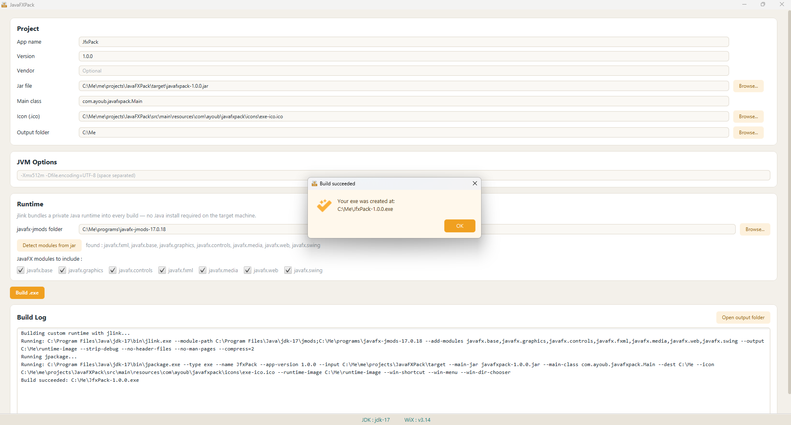

# JavaFXPack

A desktop tool that turns a JavaFX application into a standalone Windows `.exe` installer, without typing `jlink` and `jpackage` commands by hand.

Windows only. Output type is `.exe` only.



## What it does

You pick your app's jar, fill in a few fields, and click **Build .exe**. JavaFXPack then :

1. Checks that the JDK and WiX Toolset are installed.
2. Validates your settings and lists every problem at once.
3. Builds a trimmed private Java runtime with `jlink` (JDK modules + your JavaFX modules).
4. Runs `jpackage` to create the installer, with a desktop shortcut, a Start menu entry and an install folder chooser.
5. Streams the output of both tools into a live build log.

The runtime is always built with jlink: a standard JDK doesn't ship JavaFX, so there is no working jpackage path without it. The final exe needs no Java installed on the target machine.

## Features

- Automatic detection of the JDK (`JAVA_HOME`, then `C:\Program Files\Java`) and WiX Toolset v3 (`WIX` variable, then Program Files), done in the background at startup.
- Status chips at the bottom showing the detected JDK and WiX versions (green when found, red when missing). The Build button stays disabled until both are found.
- Form for app name, version, vendor, jar, main class, icon (`.ico`), output folder and JVM options.
- Browse dialogs for the jar, icon, output folder and javafx-jmods folder.
- **Detect modules from jar**: scans the jar's classes and `.fxml` files for JavaFX usage and ticks the matching module checkboxes.
- Pre-flight validation (missing files, wrong icon type, unwritable output folder, no modules selected, and so on).
- Build runs on a background thread, with a progress bar and live log, so the UI never freezes.
- **Open output folder** button after a build.
- Alert dialogs : information, warning, error.
- styling through a single CSS file.

## Requirements

| Tool | Version | Why |
|---|---|---|
| JDK | 17 or newer, with `jpackage` and `jlink` | Both tools ship with the JDK |
| WiX Toolset | v3.x (tested with v3.14) | `jpackage --type exe` calls `candle.exe` and `light.exe` |
| javafx-jmods | Same version as your app's JavaFX | `jlink` needs it to build the runtime |
| Maven | 3.6+ | Build and run |

- WiX 3: https://github.com/wixtoolset/wix3/releases (the installer may ask to enable .NET Framework 3.5). Restart your terminal/IDE after installing so the `WIX` variable is visible.
- javafx-jmods: download the "jmods" package for Windows from https://gluonhq.com/products/javafx/ and unzip it.

## Tech stack

- Java, JavaFX 21.0.2 (`javafx-controls`, `javafx-fxml`)
- Maven (`javafx-maven-plugin` 0.0.8, `maven-compiler-plugin` 3.13.0)
- Lombok 1.18.32
- `jlink` and `jpackage` (from the JDK) and WiX Toolset v3 (external)

## Run

```
mvn javafx:run
```

## Usage

1. Start JavaFXPack and wait for the JDK and WiX chips to turn green.
2. Choose your jar and enter its main class (e.g. `com.ayoub.myapp.Main`).
3. Set the output folder and the javafx-jmods folder.
4. Click **Detect modules from jar**, or tick the JavaFX modules manually.
5. Optionally set an icon and JVM options, separated by spaces (e.g. `-Xmx512m -Dfile.encoding=UTF-8`).
6. Click **Build .exe**.

When it finishes, the exe installer is in the output folder, next to the generated `runtime-image` folder.

## Project structure

```
com.ayoub.javafxpack
├── Main.java                       entry point, loads main.fxml and style.css
├── models/
│   ├── ProjectConfig               settings of one packaging job
│   ├── ToolchainInfo               detected JDK/WiX paths, versions and flags
│   ├── BuildResult                 success flag, exit code, exe path, log
│   └── ValidationResult            collected validation errors
├── services/
│   ├── ToolsLocatorService         finds the JDK, jpackage, jlink and WiX
│   ├── JavaFxModuleDetector        maps JavaFX usage in a jar to module names
│   ├── ValidationService           pre-flight checks before any process runs
│   ├── JlinkService                builds the runtime image
│   └── JpackageService             builds and runs the jpackage command
├── process/
│   ├── ProcessRunner               runs an external command, streams its output
│   └── BuildTask                   background Task: jlink, then jpackage
└── ui/
    └── MainController              wires main.fxml to the services

resources/com/ayoub/javafxpack
├── fxml/main.fxml
├── css/style.css
└── icons/
```

## How a build flows

```
Build button
   → collectConfig()                 form → ProjectConfig
   → ValidationService.validate()    errors → warning alert, stop
   → BuildTask (background thread)
        → JlinkService.buildRuntime()     → runtime-image folder
        → JpackageService.run()           → .exe installer
   → onBuildFinished()               result alert, Open output folder enabled
```

The layers only depend downward: UI → services → process, with the models shared by all. Only `ProcessRunner` touches `ProcessBuilder`, and the UI never blocks on an external command.

## Notes and known limitations

- JVM options are split on whitespace, so a single option containing spaces isn't supported yet.
- jpackage's `--input` is the jar's parent folder, and everything in it is bundled. Keep the jar in its own folder (a `target/` folder works).
- Each build deletes and recreates `<output>\runtime-image`.
- The module detector reads class files as text, so it finds JavaFX packages used by your own classes. Modules only needed indirectly are pulled in by jlink automatically.

## Author

Ayoub Elhatab: [GitHub](https://github.com/Ayoub-Elhatab) · [LinkedIn](https://www.linkedin.com/in/ayoub-elhatab/)